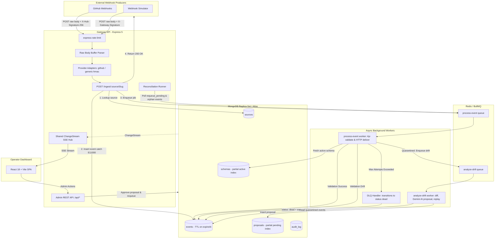

# Hookmend — Self-Healing Webhook Gateway

A resilient, domain-agnostic webhook gateway that absorbs external webhooks, validates payloads against versioned JSON Schemas, quarantines drifted payloads, and generates schema repair proposals for operator review.

[](LICENSE)
[](https://github.com/Yuvaraj-ui132/hookmend/actions/workflows/ci.yml)

---

## The Problem

External webhook producers frequently introduce payload changes without prior warning, altering field types, adding nested objects, or deprecating required attributes. When downstream consumer applications encounter these unexpected structural mutations, processing pipelines crash, event queues stall, and critical data is silently lost. Engineering teams are forced to manually inspect application logs, triage failures, patch data models, and request webhook re-transmissions under incident conditions.

---

## What It Does

Hookmend intercepts incoming webhooks and executes the following self-healing pipeline:

1. **Raw Body Cryptographic Verification:** Computes HMAC-SHA256 signatures over the exact, unparsed request body buffer using timing-safe comparison (`crypto.timingSafeEqual`) and enforces timestamp tolerance windows.
2. **Strict Deduplication:** Ensures at-most-once ingestion by leveraging a compound unique database index (`sourceId` + `eventId`), returning HTTP 200 with `deduplicated: true` for redundant submissions.
3. **Durable Persistence:** Stores incoming events in MongoDB before acknowledging receipt to prevent data loss on crash.
4. **Asynchronous Enqueueing:** Dispatches accepted events to a BullMQ Redis queue (`process-event`) using fail-fast producer semantics.
5. **Schema Validation:** Evaluates payloads against active versioned JSON Schema definitions (Draft-07) using compiled Ajv validators.
6. **Quarantine on Drift:** Identifies schema divergence without dropping payloads, isolates drifted events in a `quarantined` state, and computes a canonical `driftFingerprint`.
7. **Deterministic Baseline Schema Fix:** Automatically synthesizes a backward-compatible draft schema resolving missing or type-widened fields.
8. **Optional Redacted AI Proposal:** When enabled, queries Google Gemini with structural diff metadata (field names and primitive types only, never values or PII) to suggest clean schema updates.
9. **Human Approval with Replay Check:** Allows operators to inspect structural diffs in a web UI, run candidate schemas against quarantined payloads in memory, and edit proposed schemas.
10. **Transactional Activation & Redelivery:** Atomically deactivates historical schemas, activates the candidate version, flags affected events as `requeue_pending`, and enqueues them for downstream delivery.

---

## Demo

<!-- demo GIF goes here: docs/media/demo.gif -->

The demonstration demonstrates:
1. Receiving valid synthetic webhooks and forwarding them downstream to an HTTP receiver.
2. Injecting breaking schema drift (e.g., changing numerical amounts to currency strings, removing order IDs).
3. Immediate quarantine of non-conforming events and real-time alert dispatch to the React dashboard over Server-Sent Events.
4. Reviewing the structural diff and automated schema migration proposal in the dashboard interface.
5. In-memory validation replay against quarantined events and transactional schema activation.
6. Safe re-enqueueing and at-least-once delivery of recovered events.

---

## Architecture



### Component Summary

| Component | Package / Path | Primary Technology | Responsibility |
| --- | --- | --- | --- |
| Ingest API | `packages/api` | Express 5, Node.js | Signature validation, deduplication, raw body buffering, event persistence, admin REST endpoints. |
| Event Worker | `packages/worker` | BullMQ, Ajv, ioredis | Payload validation, downstream HTTP delivery with backoff, dead-letter classification. |
| Drift Worker | `packages/worker` | Google Gen AI SDK, BullMQ | Deterministic structural diffing, optional Gemini schema proposal synthesis, candidate replay verification. |
| Storage | `infra/docker-compose.yml` | MongoDB 7 (Replica Set `rs0`) | Idempotent compound unique indices, partial active/pending schema filters, TTL on terminal states. |
| Message Broker | `infra/docker-compose.yml` | Redis 7 | BullMQ job coordination, rate limiting, and failure backoff schedules. |
| Dashboard | `packages/dashboard` | React 18, Vite 5, React Router 6 | Real-time event monitoring, quarantine inspection, candidate schema editing, and approval workflow. |
| Simulator | `packages/simulator` | Node.js | Synthetic payment-shaped webhook generation with configurable mutation profiles and HMAC signing. |

---

## Quickstart

### Prerequisites
- **Node.js**: `>= 20.0.0` (per `engines` field in `package.json`)
- **Docker**: Docker Engine & Docker Compose

### Step 1: Clone and Install
```bash
git clone https://github.com/Yuvaraj-ui132/hookmend.git
cd hookmend
npm install
```

### Step 2: Environment Setup
```bash
cp .env.example .env
```
> **Note**: For the web simulator to run drift scenarios via the dashboard, ensure `ENABLE_SIMULATOR_API=true` is set in your `.env` file.

### Step 3: Start Backing Services
```bash
docker compose -f infra/docker-compose.yml up -d
```

### Step 4: Seed Database
Populate default source definitions and schemas:
```bash
npm run seed
```

### Step 5: Start Components
Open separate terminal tabs or background sessions for each service:

1. **Start downstream test receiver:**
   ```bash
   node packages/simulator/src/receiver.js
   ```
2. **Start async worker:**
   ```bash
   node packages/worker/src/main.js
   ```
3. **Start Gateway API:**
   ```bash
   npm run dev
   ```
4. **Start Operator Dashboard:**
   ```bash
   npm run dev:dashboard
   ```

### Step 6: Access Dashboard
1. Open [http://localhost:5173](http://localhost:5173) in your browser.
2. Sign in using the value configured for `ADMIN_API_TOKEN` in `.env` (default in `.env.example`: `change-me`).
3. Navigate to the **Simulator** page to dispatch valid and mutated webhook payloads.

---

## Configuration

All configuration is driven through environment variables. Defaults from `.env.example`:

| Environment Variable | Default Value | Description |
| --- | --- | --- |
| `MONGODB_URI` | `mongodb://localhost:27017/hookmend?directConnection=true` | MongoDB connection URI (replica set required for ChangeStreams). |
| `PORT` | `3000` | HTTP listen port for the Gateway API. |
| `NODE_ENV` | `development` | Node runtime environment (`development`, `production`, `test`). |
| `MAX_BODY_SIZE` | `524288` | Ingest body size limit in bytes (512 KB). |
| `TIMESTAMP_TOLERANCE_SECONDS` | `300` | Maximum allowable skew for incoming request timestamps (seconds). |
| `INGEST_RATE_LIMIT_MAX` | `100` | Maximum requests per client per window. |
| `INGEST_RATE_LIMIT_WINDOW_MS` | `60000` | Window duration for ingest rate limiter (ms). |
| `EVENT_TTL_DAYS` | `14` | Expiration retention period for delivered/dead events. |
| `LOG_LEVEL` | `info` | Pino log level (`debug`, `info`, `warn`, `error`). |
| `GITHUB_WEBHOOK_SECRET` | `change-me` | Shared HMAC secret for GitHub webhook verification. |
| `SIM_WEBHOOK_SECRET` | `change-me` | Shared HMAC secret for synthetic webhook simulator. |
| `REDIS_URL` | `redis://localhost:6379` | Redis connection URL for BullMQ. |
| `QUEUE_PREFIX` | `hookmend` | Key prefix for BullMQ Redis queues. |
| `WORKER_CONCURRENCY` | `5` | Concurrent event processing jobs per worker process. |
| `PROCESS_EVENT_ATTEMPTS` | `5` | Maximum retry attempts for downstream delivery. |
| `PROCESS_EVENT_BACKOFF_BASE_MS` | `1000` | Initial exponential backoff delay (ms). |
| `PROCESS_EVENT_BACKOFF_MAX_MS` | `30000` | Maximum backoff delay cap (ms). |
| `DOWNSTREAM_TIMEOUT_MS` | `10000` | HTTP delivery request timeout (ms). |
| `RECONCILE_INTERVAL_MS` | `300000` | Periodic reconciliation check interval (ms). |
| `RECONCILE_MIN_AGE_MS` | `60000` | Minimum age before an unhandled event is reconciled (ms). |
| `RECONCILE_BATCH` | `500` | Batch query size for orphan event reconciliation. |
| `STALE_JOB_THRESHOLD_MS` | `300000` | Age threshold to re-enqueue stuck in-flight jobs. |
| `ADMIN_API_TOKEN` | `change-me` | Bearer token for administrative REST endpoints. |
| `ENABLE_AI` | `false` | Enable Google Gemini AI schema proposals (off by default). |
| `GEMINI_API_KEY` | *(empty string)* | Google Gen AI API key. |
| `GEMINI_MODEL` | `gemini-2.0-flash` | Gemini model identifier for schema analysis. |
| `GEMINI_RPM_LIMIT` | `10` | Gemini API request-per-minute throttle. |
| `GEMINI_RPD_LIMIT` | `100` | Gemini API request-per-day throttle. |
| `MAX_SCHEMA_BYTES` | `102400` | Maximum allowable byte size for JSON schemas. |
| `REPLAY_MAX_EVENTS` | `1000` | Cap on quarantined events evaluated during candidate schema replay. |
| `SSE_HEARTBEAT_MS` | `25000` | Interval between SSE keep-alive comments (ms). |
| `MAX_SSE_CLIENTS` | `20` | Maximum concurrent SSE dashboard connections. |
| `DASHBOARD_ORIGINS` | `http://localhost:5173` | Allowed CORS origins for administrative routes. |
| `ENABLE_SIMULATOR_API` | `false` | Enable the `/api/simulate` endpoint for web-based drift demos. |
| `SIMULATOR_SOURCES` | `sim-payments` | Comma-separated slug list of sources permitted for simulation. |
| `ALLOW_PRIVATE_DOWNSTREAM` | `false` | Allow loopback/RFC1918 downstream delivery destinations (dev only). |
| `WORKER_LOCK_DURATION_MS` | `30000` | BullMQ worker lock duration (ms). |
| `WORKER_STALLED_INTERVAL_MS`| `30000` | BullMQ worker stalled check interval (ms). |
| `WORKER_MAX_STALLED_COUNT` | `1` | Maximum stalled attempts before failure. |

> **Privacy Guard:** `ENABLE_AI` is disabled by default. When enabled, only a redacted structural diff (field paths and primitive data types) is transmitted to the AI provider. Raw payload contents, customer identifiers, and secrets are strictly excluded from AI prompts.

---

## Testing

The project incorporates comprehensive unit, integration, chaos, and load testing suites:

| Command | Target / Scope | Validation Objective |
| --- | --- | --- |
| `npm test` | Vitest (32 suites, 325 tests) | In-memory validation of adapters, routes, diff engines, and queue abstractions without external dependencies. |
| `npm run exit-test:phase1` | Integration (Docker required) | Verifies raw-body HMAC verification, database persistence, and deduplication under load. |
| `npm run exit-test:phase2` | Integration (Docker required) | Validates BullMQ queue dispatch, Ajv schema validation, downstream HTTP delivery, and retry backoffs. |
| `npm run exit-test:phase3a` | Integration (Docker required) | Validates drift isolation, baseline schema synthesis, AI containment fallback, and transactional activation. |
| `npm run exit-test:phase3b` | Integration (Docker required) | Verifies shared MongoDB ChangeStream watcher, SSE broadcasting, SSRF URL filters, and simulator routes. |
| `npm run exit-test:phase4` | Integration (Docker required) | End-to-end integration across all subsystems, reconciliation recovery, and dead-letter handling. |
| `npm run chaos` | Fault Injection (Docker required) | Injects infrastructure crashes, kills workers mid-flight, drops Redis, and verifies system recovery. |
| `npm run load-test` | Stress Testing (Docker required) | Measures sustained throughput, p95/p99 response latencies, and queue drain dynamics. |

---

## Measured Results

> Single laptop, API in-process, local Docker services; not production capacity.

### Chaos Test Suite Results

- **Generated**: `2026-10-25T18:19:23.249Z`
- **Commit**: `dc1bf74`
- **OS**: `Windows_NT 10.0.26300`
- **Node**: `v24.16.0`
- **CPU**: `Intel(R) Core(TM) i5-8350U CPU @ 1.70GHz (8 cores)`
- **RAM**: `16 GB`
- **Queue prefix**: `hookmend-chaos`
- **Worker knobs (chaos)**: `lockDuration=4000ms`, `stalledInterval=2000ms`, `maxStalledCount=3`
- **STALE_JOB_THRESHOLD_MS (chaos)**: `10000ms`

| Scenario | Injected Fault | Assertion | Result | Recovery (s) |
|---|---|---|---|---|
| C1 | Worker SIGKILL mid-delivery (receiver slow 3s) | All 20 delivered, exactly 20 docs, 0 dead, receiver saw each id >= 1 | PASS - 20/20 delivered, 5 ids seen >1 (at-least-once), recovery 2848ms | 3 |
| C2 | Redis stopped during ingest | All 20 HTTP 200 < 3000ms, 20 stored received, all delivered after Redis restart | PASS - 20/20 HTTP 200 while Redis down; all 20 delivered in 6s post-restart (11s total) | 6 |
| C3 | Redis FLUSHALL while events in flight | All 30 delivered, 0 dead, 0 stuck in any non-terminal state | PASS - 30/30 delivered after Redis FLUSHALL; 0 duplicate deliveries (at-least-once); 3118ms total | 3 |
| C4 | 100 concurrent requests with same delivery id | 1 doc, 1 not-dedup, 99 dedup, receiver saw exactly 1 request | PASS - 1 unique doc, 1 not-dedup, 99 dedup, receiver saw 1 request | 1 |
| C5 | Downstream 503 for ~3s (shorter than retry window) | All 20 delivered, 0 dead | PASS - 20/20 delivered, 0 dead, attempt distribution: {"3":20} | 1 |
| C6 | Downstream 503 until all events dead, then requeue | All go dead; requeue via admin API; all delivered | PASS - 20 events went dead; requeued 20; all 20 delivered after recovery | 10 |
| C7 | Fake AI client always throws 429-style error | Proposal with aiUsed=false, aiFailureReason=AI_RATE_LIMITED; no crash; baseline schema exists | PASS - Proposal created with aiUsed=false, aiFailureReason=AI_RATE_LIMITED; baseline replay covered 1 events | 16 |

### Performance Load Test Results

- **Generated**: `2026-10-25T13:14:25.432Z`
- **Commit**: `f1a215d`
- **OS**: `Windows_NT 10.0.26300`
- **Node**: `v24.16.0`
- **CPU**: `Intel(R) Core(TM) i5-8350U CPU @ 1.70GHz (8 cores)`
- **RAM**: `16 GB`

#### Stage Results (Target vs. Achieved)

| Target RPS | Config Duration (s) | Actual Elapsed (s) | Attempted | Accepted | Errors | Achieved RPS | p50 (ms) | p95 (ms) | p99 (ms) | max (ms) |
|---|---|---|---|---|---|---|---|---|---|---|
| 10 | 30 | 30 | 299 | 299 | 0 | 10 | 11 | 19 | 597 | 744 |
| 25 | 30 | 30 | 749 | 749 | 0 | 25 | 10 | 26 | 173 | 352 |
| 50 | 30 | 30 | 1499 | 1499 | 0 | 50 | 11 | 147 | 424 | 561 |
| 100 | 30 | 30 | 2999 | 2999 | 0 | 99.9 | 17 | 69 | 189 | 492 |
| baseline (~8.33 target) | 180 | 180 | 1499 | 1499 | 0 | 8.3 | 8 | 13 | 31 | 108 |

#### Baseline & Pipeline Metrics
- **Target rate**: 500 events/min (~8.33 target RPS) | **Achieved rate**: 499.7 events/min
- **Configured duration**: 180s | **Actual elapsed**: 180s
- **Attempted**: 1499 requests | **Accepted (HTTP 200)**: 1499 | **Errors**: 0
- **Total attempted across all stages**: 7045 | **Accepted**: 7045 | **Delivered**: 7045 | **Dead**: 0
- **Time to drain**: 2030ms (2s)
- **Max queue depth sampled**: 0 (waiting + active + delayed)

---

## Design Decisions and Trade-offs

- **At-Least-Once Delivery**: Network partitions and downstream unresponsiveness can cause re-transmissions. Hookmend aims to deliver every accepted event, passing an `x-hookmend-event-id` header so downstream consumers can safely deduplicate.
- **Quarantine Instead of Dropping**: Non-conforming payloads are never silently dropped or rejected with HTTP 4xx (which causes webhook senders to disable integrations). Instead, they are persisted and quarantined for operator triage.
- **Human Approval Required**: AI suggestions and automated baseline repairs never auto-activate. An operator must review the candidate schema, inspect in-memory replay results, and approve activation.
- **Redacted Structural AI Context**: To preserve data privacy, Google Gemini is provided only structural diffs (field names and inferred types). No payload values, secrets, or PII ever leave the gateway boundary.
- **Self-Healing Reconciliation**: If Redis is restarted or fails during ingestion, events persist in MongoDB with status `received`. A periodic background reconciliation runner discovers unenqueued events and re-enqueues them automatically.
- **Node.js, Express, and MongoDB**: Node.js ESM provides low-overhead JSON handling and native crypto performance. Express 5 provides robust middleware scoping for raw body buffers. MongoDB provides native JSON document indexing, atomic partial unique filters, and ChangeStream support without relational migration friction.

---

## Security Model

- **Raw-Body HMAC Verification**: Signatures are evaluated strictly over raw unparsed buffers via `crypto.timingSafeEqual` to prevent timing attacks.
- **Replay Window Enforcement**: Requests with timestamps outside `TIMESTAMP_TOLERANCE_SECONDS` (past or future) are rejected.
- **Strict Ingest Rate Limiting**: Express middleware limits ingestion bursts per source and IP to prevent denial-of-service.
- **Zero Payload Values in Logs and AI**: Logging configurations redact secrets and signatures; SSE streams and AI prompts completely filter out payload values.
- **Administrative Token Protection**: Admin REST endpoints require a static Bearer token passed in the `Authorization` header.

---

## Status and Limitations

> [!WARNING]
> Hookmend is an experimental reference implementation and architectural demonstration. It is **NOT** certified or intended for production payment handling, financial transactions, or unreviewed production deployments.

### Blunt Known Limitations
1. **Single Worker Instance**: Background reconciliation assumes a single worker process without distributed leader election. Multi-worker scaling requires distributed locking (e.g., Redlock or Mongo leases) to avoid duplicate reconciliation sweeps.
2. **In-Memory SSE Subscriber Hub**: The Server-Sent Events hub runs in-memory per API server process without a shared Redis Pub/Sub backplane. Horizontal API scaling requires an external broadcast adapter.
3. **No SSE Server-Side Replay Buffer**: Disconnected SSE clients must trigger state resynchronization upon reconnection; historical broadcast frames are not buffered in Redis.
4. **Static Administrative Bearer Token**: Authentication uses a shared static bearer token rather than fine-grained role-based access control (RBAC) or multi-tenant JWTs.
5. **DNS Rebinding Exposure**: Downstream destination URL validation checks private IP ranges at configuration time but does not pin DNS lookups during downstream HTTP dispatch.
6. **Free-Tier Assumptions**: Defaults and connection pools are tailored for MongoDB Atlas M0 (500 max connections) and Gemini Free Tier rate limits.
7. **CI Status**: Master branch GitHub Actions CI verified passing.

### Current Dependency Advisories

Reported from `npm audit` run:

#### Production Dependencies (`npm audit --omit=dev --audit-level=high` exited with code 0)
- `react-router` / `react-router-dom` 6.x: 2 Moderate vulnerabilities (`GHSA-wrjc-x8rr-h8h6`, `GHSA-337j-9hxr-rhxg`). Both relate to server-side rendering (SSR) hydration and backslash link redirects. Since the operator dashboard is built and served as a static single-page application (SPA) with no SSR hydration, there is no exploitable attack surface. Fixing requires a breaking upgrade to v7 (`npm audit fix --force`).

#### Development Dependencies (`npm audit` exited with code 1)
- `tinypool` (`GHSA-5gmw-xhrv-c9v3`, `GHSA-85c8-ppgw-ccpr`): 2 Critical vulnerabilities within Vitest test runner dependency chain.
- `follow-redirects` (`GHSA-mrwp-f3q8-3g9p`): 2 High vulnerabilities within Vitest sub-dependencies.
- `@vitest/mocker`, `esbuild`, `vite`: 5 Moderate vulnerabilities within local build/test tooling.

---

## Project Structure

```
.
├── infra/
│   ├── docker-compose.yml       # MongoDB 7 replica set (rs0) & Redis 7
│   └── seed/seed.js             # Initial source and schema seed script
├── packages/
│   ├── api/                     # Express 5 Webhook Gateway & Admin REST API
│   ├── common/                  # Shared constants, DB client, logger, Ajv, diff engine
│   ├── dashboard/               # React 18 + Vite 5 Operator Dashboard
│   ├── simulator/               # Synthetic webhook generator and test receiver
│   └── worker/                  # BullMQ processor, drift worker, and chaos scripts
├── docs/                        # Specifications, chaos matrices, and benchmarks
├── package.json                 # Monorepo workspaces configuration
├── CONTRIBUTING.md
├── LICENSE
└── SECURITY.md
```

---

## Roadmap

Tracked development goals from `docs/SPEC.md`:
- [x] Phase 1: Core ingest, raw-body HMAC adapters, MongoDB persistence, strict deduplication.
- [x] Phase 2: BullMQ queue integration, Ajv schema validation worker, exponential backoff delivery, DLQ handling.
- [x] Phase 3A: Quarantine state machine, deterministic diffing, Google Gemini AI proposal synthesis, candidate replay.
- [x] Phase 3B: Shared ChangeStream SSE stream, React operator dashboard, SSRF downstream guards, webhook simulator.
- [x] Phase 4: Chaos testing suite (C1–C7), performance load benchmarks, CI automation.
- [ ] Distributed Leader Election: Implement Redis-based distributed locking (Redlock) for multi-worker reconciliation.
- [ ] Redis Pub/Sub SSE Fan-out: Enable multi-instance API horizontal scaling with cross-node broadcast.
- [ ] Downstream DNS Pinning: Implement custom HTTP Agent to pin DNS resolutions and mitigate DNS rebinding.
- [ ] Upgrade Dashboard to React Router v7: Eliminate moderate dependency advisories.

---

## Contributing

Review [CONTRIBUTING.md](CONTRIBUTING.md) for local development instructions, test suites, and the provider adapter contract.

## Security

Review [SECURITY.md](SECURITY.md) for vulnerability disclosure policies and scope boundaries.

## License

[MIT](LICENSE) © 2026 Yuvaraj Murkunde
