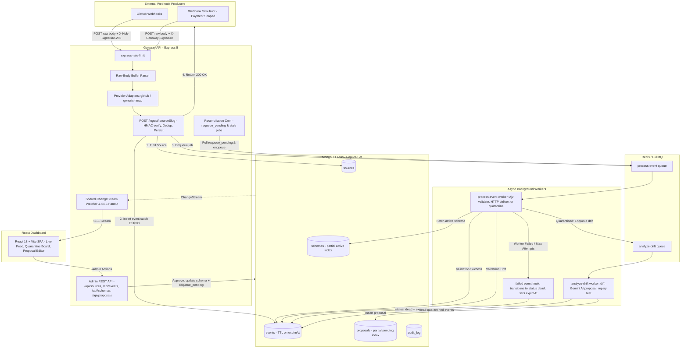
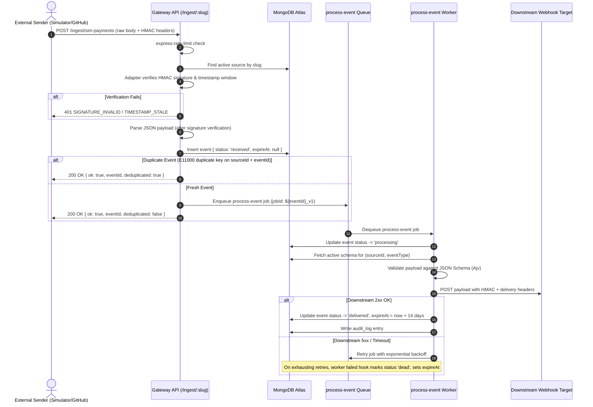
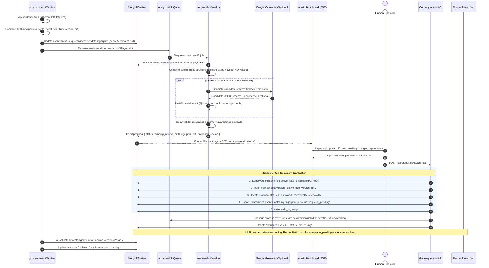

# Hookmend — Self-Healing Webhook Gateway
## Project Specification v0.2.0

> **STATUS:** Single Source of Truth — Approved Blueprint (incorporating Phase 1 architecture refinements & decision log resolutions).  
> **SCOPE NOTE:** This document governs all architectural contracts, schemas, interfaces, and testing criteria. No application code shall deviate from this specification without prior agreement and a corresponding update to this document and its decision log.

---

## Table of Contents

1. [Overview, Goals, Non-Goals](#1-overview-goals-non-goals)
2. [Tech Stack and Decision Log](#2-tech-stack-and-decision-log)
3. [Architecture Diagram and Component Responsibilities](#3-architecture-diagram-and-component-responsibilities)
4. [End-to-End Flow with Sequence Diagram](#4-end-to-end-flow-with-sequence-diagram)
5. [State Machines](#5-state-machines)
6. [MongoDB Schema Design](#6-mongodb-schema-design)
7. [HTTP API](#7-http-api)
8. [Queue Design](#8-queue-design)
9. [Provider Adapter Interface](#9-provider-adapter-interface)
10. [AI Layer](#10-ai-layer)
11. [Security](#11-security)
12. [Observability](#12-observability)
13. [Frontend](#13-frontend)
14. [Repository Structure](#14-repository-structure)
15. [Environment Variables](#15-environment-variables)
16. [Testing Strategy](#16-testing-strategy)
17. [Roadmap](#17-roadmap)
18. [Risks and Known Limitations](#18-risks-and-known-limitations)
19. [Resolved Architecture Decisions (formerly Open Questions)](#19-resolved-architecture-decisions-formerly-open-questions)
- [Appendix A: Drift Fingerprint Algorithm](#appendix-a-drift-fingerprint-algorithm)
- [Appendix B: Gemini Prompt Template](#appendix-b-gemini-prompt-template)

---

## 1. Overview, Goals, Non-Goals

### What Hookmend Is

Hookmend is an open-source, domain-agnostic webhook gateway designed to absorb incoming webhooks reliably, validate payloads against versioned JSON Schemas, quarantine unparseable or drifted events, and automate schema repair proposals for human approval.

It is explicitly **domain-agnostic**: it never processes payments, mutates business domain state, or executes business transactions. It purely transports, verifies, stores, validates, and heals message contracts.

Key responsibilities:
- Receives webhooks from external providers (demonstrated with GitHub and a synthetic payment-shaped Webhook Simulator).
- Verifies cryptographic signatures (HMAC-SHA256) over raw request bodies before any parsing.
- Stores every verified message reliably in MongoDB Atlas before acknowledging with HTTP 200.
- Decouples receipt from validation and downstream delivery via an asynchronous queue (BullMQ + Redis).
- Validates payloads against active JSON Schemas using Ajv.
- Detects schema drift, quarantines non-matching events, and clusters them by a deterministic `driftFingerprint`.
- Drafts structural repair proposals (deterministically, augmented with Google Gemini structured output when enabled) for human review.
- Replays quarantined events against candidate schemas before human approval.
- Re-enqueues quarantined events safely upon schema activation.
- Streams live system status and audit events to a React dashboard over Server-Sent Events (SSE).

### Goals

| # | Goal | Measurable Success Criteria |
|---|------|----------------------------|
| G1 | Reliable Ingest | 100% of cryptographically valid webhooks are persisted to MongoDB before HTTP 200 is issued. |
| G2 | Pluggable Verification | Extensible adapter interface supporting provider-specific HMAC headers, tolerance windows, and canonical raw bodies. |
| G3 | Strict Deduplication | Concurrent identical deliveries result in exactly 1 persisted document and 0 duplicate queue jobs via compound unique index. |
| G4 | Safe Schema Drift Handling | Payloads failing schema validation are quarantined without data loss; valid payloads proceed to delivery without delay. |
| G5 | Isolated AI Repair | Gemini proposes structural schema updates with strictly zero payload data or secret exposure. AI proposals never auto-activate. |
| G6 | Zero-Cost Infrastructure | Fully functional on free-tier infrastructure: MongoDB Atlas (M0 512 MB), local Docker Redis, Gemini API free tier, Render/Vercel. |

### Non-Goals

| # | Non-Goal | Rationale |
|---|----------|-----------|
| NG1 | Payment Processing / Fund Movement | Hookmend is pure message infrastructure. Payment-shaped simulator data is purely synthetic. |
| NG2 | Out-of-the-Box Multi-Tenancy | Built as a single-organization reference gateway. Multi-tenant isolation is deferred. |
| NG3 | Dynamic Ingest Route Registration | Sources are configured via DB/Admin API, but routing is handled via slug lookup (`/ingest/:sourceSlug`). |
| NG4 | End-to-End Payload Encryption | Payloads are stored in MongoDB plaintext for demonstration. Production field-level encryption is out of scope. |
| NG5 | Automated Schema Auto-Approval | AI proposals MUST be reviewed, validated via replay, and approved by an authorized human operator. |

---

## 2. Tech Stack and Decision Log

### Stack Summary

| Layer | Choice |
|-------|--------|
| Runtime | Node.js 20+ (ESM modules) |
| Web Framework | Express 5 |
| Ingest Rate Limiting | express-rate-limit (HTTP layer, memory or Redis-backed) |
| Database | MongoDB Atlas free cluster / local Mongo replica set (official `mongodb` native driver) |
| Queue Broker | Redis via BullMQ (in Phase 1: queue stub with identical interface; BullMQ in Phase 2) |
| Schema Validation | Ajv (JSON Schema draft-07 / 2019-09) |
| HMAC Cryptography | Node.js built-in `node:crypto` (`timingSafeEqual`) |
| AI Integration | Google Gen AI SDK (`@google/genai` or `@google/generative-ai`), default model `gemini-2.0-flash` |
| Live Push | Server-Sent Events (SSE) with single shared ChangeStream watcher per process |
| Frontend | React 18 + Vite (plain CSS, fetch-based SSE stream, runtime token prompt) |
| Structured Logging | Pino (ndjson structured output, raw signature redaction) |
| Testing | Vitest + Supertest + mongodb-memory-server |
| Repository Model | Monorepo using npm workspaces (`packages/api`, `packages/worker`, `packages/simulator`, `packages/dashboard`) |

### Decision Log

| Decision | Chosen | Alternatives Considered | Reason | Trade-off / Note |
|----------|--------|------------------------|--------|------------------|
| Language & Modules | JavaScript ESM (`"type": "module"`), Node >=20 | TypeScript, CommonJS | Lower friction, clean standard syntax, native ESM support. | Relies on JSDoc and comprehensive test suites for typing. |
| Database Driver | MongoDB native driver (`mongodb`) | Mongoose, Prisma | Transparent index creation, exact pipeline control, no ODM magic. | Manual schema validation and index lifecycle scripts. |
| Events TTL | `expireAt` field index with `expireAfterSeconds: 0` | TTL on `receivedAt` | Quarantined and processing events must NEVER expire. TTL is set only on status `delivered` or `dead`. | Worker/delivery logic must explicitly compute and set `expireAt` upon terminal delivery or exhaustion. |
| Schemas Unique Index | Unique partial index on `{ sourceId: 1, eventType: 1 }` with `partialFilterExpression: { active: true }` | Sparse unique index on `{ sourceId, eventType, active }` | In MongoDB, sparse index on boolean field considers `active: false` as a distinct value, preventing multiple inactive historical schemas. Partial index allows infinite inactive versions while guaranteeing exactly one active version. | Standard MongoDB best practice for active flag exclusivity. |
| Proposals Unique Index | Compound unique partial index on `{ sourceId: 1, eventType: 1, driftFingerprint: 1 }` with `partialFilterExpression: { status: "pending_review" }` | Unique index on `driftFingerprint` | Scope is strictly per source and event type. Furthermore, rejecting a proposal must allow a fresh proposal for the same drift. | Rejection marks status `rejected`, releasing the unique constraint for subsequent drift runs. |
| Queue Ingestion & Stub (Phase 1) | In-memory Queue Stub for Phase 1 with exact BullMQ signature `enqueue(queueName, jobName, data, opts)` | Immediate BullMQ dependency in Phase 1 | Keeps Phase 1 focused strictly on core HTTP ingest, raw body HMAC, and MongoDB persistence without requiring Redis upfront. | Deviation approved; stub maintains exact signature so Phase 2 replaces only the implementation. |
| Dual-Write Mitigation (Approve Flow) | Two-phase approve: Mongo transaction sets schema active, proposal approved, events `requeue_pending`. Post-commit enqueues to BullMQ; reconciliation job cleans up orphans. | Distributed 2PC, Redis inside Mongo transaction | MongoDB transactions cannot encompass Redis. Marking `requeue_pending` guarantees durability and crash safety. | Requires background reconciliation job to catch any enqueue failures if API crashes mid-flight. |
| Ingest Rate Limiting | `express-rate-limit` at HTTP route layer | BullMQ queue-level rate limiter | Ingest rate limiting must protect Express, memory, and MongoDB Atlas connection pools before DB writes occur. Queue limiter is too late. | Requires configuring rate limiter on ingest route. |
| Dead-Letter Queue | Worker `failed` event hook when `job.attemptsMade >= job.opts.attempts` | Separate BullMQ DLQ queue | BullMQ lacks built-in automatic dead-letter routing. Handling within `failed` event directly transitions Mongo status to `dead`, writes audit log, and sets `expireAt`. | Explicit worker event listener required. |
| SSE Architecture & Auth | Single shared MongoDB ChangeStream watcher fanned out to connected clients; fetch-based SSE client with Bearer auth or query token. | Per-client ChangeStream; standard browser `EventSource` | Standard browser `EventSource` cannot send custom `Authorization` headers. Atlas M0 has strict connection and ChangeStream limits; 1 shared watcher protects Atlas. | Dashboard uses fetch-based streaming client (or short-lived query token) and requests token at runtime. |
| Generic HMAC Contract | Signs `${timestamp}.${rawBody}` | Signing raw body only | Binding timestamp to raw body protects against timestamp tampering and replay attacks. Intentionally stricter than standard YouPI. | Simulator and sender must concatenate timestamp and raw body before signing. |
| Monorepo Architecture (OQ1, OQ5) | Single repo with npm workspaces (`packages/*`) | Multi-repo, polyrepo | Streamlined CI/CD, atomic cross-package commits, shared scripts. | Root `package.json` configures workspaces. |
| Rejected Proposal Policy (OQ2) | Events stay quarantined, proposal marked `rejected`; allows re-analysis on subsequent payloads. | Mark events dead immediately | Human rejection indicates proposal was flawed, not necessarily that events are invalid garbage. | Operator can re-trigger analysis or update schema manually. |
| Schema Proposal Editing (OQ3) | Operator can edit `proposedSchema` in dashboard; replay validation re-runs before commit. | Read-only proposals | Humans often need to fine-tune field types or nullability before applying schema fixes. | Dashboard includes JSON editor; API re-verifies schema with Ajv replay on approve. |
| Local MongoDB Replica Set (OQ4) | Single-node replica set in `docker-compose.yml` with automatic initialization (`rs.initiate()`) | Standalone MongoDB | ChangeStreams require a replica set in local development matching Atlas behavior. | Connection string requires `replicaSet=rs0&directConnection=true`. |
| GitHub Webhook Scope (OQ6) | Primary demo focuses on `push` event | All 40+ GitHub event types | Focused demo contract with high clarity and manageable schema seeds. | Additional events can be seeded easily. |
| Admin Authentication (OQ7) | Static Bearer token in environment variable (`ADMIN_API_TOKEN`) with runtime dashboard entry | Multi-tenant OAuth / JWT | Keeps reference gateway simple and zero-dependency for initial releases. | Documented as known limitation for multi-tenant production. |
| **[Phase 1] Flat Error Format** | `{"error":"SNAKE_CASE","message":"...","requestId":"..."}` (flat, no nesting) | Nested `{"error":{"code":"...","message":"...",...}}` as originally specced in §7 | Simpler for consumers; easier to extend. Phase 2 admin routes may adopt the nested form per original spec if needed. | Deviation from §7 Unified Error Format. Ingest and health routes use the flat form. |
| **[Phase 1] 413 for Oversized Body** | HTTP 413 `PAYLOAD_TOO_LARGE` when body exceeds `MAX_BODY_SIZE` | 400 Bad Request as originally mentioned in an earlier spec draft | HTTP 413 is semantically correct for payload size violations; 400 is a generic client error. Express `express.raw` already surfaces this as 413 natively. | Deviation from any prior "400" references; §7 already documents 413 as the correct code (adopted). |
| **[Phase 1] Missing Event Type** | Returns 400 `INVALID_PAYLOAD` when `eventType` is absent after successful HMAC verification | 400 `INVALID_JSON` or other code | Event type is a mandatory routing field. Separate code improves debuggability. | Not in original error table in §7; added to table in this update. |
| **[Phase 1] Rate-Limit Key: slug+ip** | Rate limit keyed by `${sourceSlug}:${req.ip}` with `app.set('trust proxy', 1)` | IP-only key | Per-source isolation prevents one misbehaving source from consuming another's allowance. Trust-proxy ensures correct client IP behind reverse proxies/load balancers. | `trust proxy` must be set before `express-rate-limit` key generator reads `req.ip`. |
| **[Phase 1] /health redis field** | Returns `"redis": "not_configured"` in Phase 1 | Omit redis field or return "disconnected" | Communicates intentional Phase 1 scope; Phase 2 BullMQ integration will return actual Redis status. | Deviates slightly from §7 shape which shows `"redis": "connected"`; Phase 2 will correct this. |
| **[Phase 1] expireAt omitted until terminal status** | `expireAt` field is ENTIRELY OMITTED from event documents until status becomes `delivered` or `dead` | Store `expireAt: null` | MongoDB TTL index with `expireAfterSeconds: 0` fires on documents where `expireAt <= Date.now()`. Storing `null` would require a sparse index or special handling. Omitting the field entirely prevents accidental TTL deletion. | `expireAt` sparse TTL index (with `sparse: true`) only processes documents where the field exists. Phase 2 worker must set `expireAt = new Date(Date.now() + EVENT_TTL_DAYS * 86400000)` on terminal transitions. |
| **[Phase 3 Note] analyze-drift jobId** | `analyze-drift` jobId for re-analysis attempts MUST include an attempt counter (e.g. `${fingerprint}_a${attemptN}`) to prevent BullMQ from deduplicating re-analysis after a rejected proposal. | `${fingerprint}` only | BullMQ treats identical jobIds as deduplicated. A rejected proposal must allow a fresh analysis run, which requires a unique jobId. | Phase 3 implementation must track attempt count per fingerprint, likely in the `proposals` document. |
| **[Phase 2] D1 Shared Packages** | Add `@hookmend/common` and `@hookmend/worker`; move logger, db client, constants, queue factory, audit helper, diff, and fingerprint into common. | Keep all shared code duplicated or in API | Clear package boundaries allow independent deployment and horizontal scaling of workers. | API and worker both depend on `@hookmend/common`. |
| **[Phase 2] D2 Event Statuses** | Standardized status enum: `received`, `processing`, `delivered`, `quarantined`, `failed`, `dead`, `requeue_pending`. | Ad-hoc statuses | Explicit status finite state machine prevents illegal state transitions. | Centralized in `EVENT_STATUS` constants. |
| **[Phase 2] D3 Event Fields** | Worker adds `schemaVersion`, `validated`, `lastError`, `quarantinedAt`, `processedAt`, `downstreamStatus`, `requeueSeq`, `validationErrors` (max 20). `expireAt` set ONLY on terminal `delivered` or `dead`. | Store nulls or raw error stacks | Value-free errors prevent data leakage; conditional TTL prevents premature event pruning. | Implemented in processor and schema validator. |
| **[Phase 2] D4 Conditional State Updates** | Updates use `updateOne` with status filter (`status: { $in: [...] }`) to prevent overwriting terminal states; already terminal/quarantined events skipped. | Unconditional updates | Prevents race conditions from overwriting `delivered` or `dead` states. | Verified in concurrency tests. |
| **[Phase 2] D5 No Active Schema Delivery** | If no active schema exists for `(sourceId, eventType)`, deliver without validation, set `validated: false`, `schemaVersion: null`, and log warn. | Reject with 400 or drop event | Unconfigured schemas should not drop valid webhook deliveries in gateway mode. | Allows graceful fallback. |
| **[Phase 2] D6 Ajv Draft-07 Wrapper** | Ajv draft-07 with `allErrors: true` and `strict: false`, cached by schema `_id + version`. Convert to `[{path, keyword}]` only. | Re-compile per event or leak error params | Fast cached validation while strictly avoiding payload values in errors. | Value-free validation errors capped at 20 items. |
| **[Phase 2] D7 Value-Free Structural Diff** | Recursive comparison of schema.properties and payload for objects (depth <= 5). `added`, `removed`, `typeChanged`. Number accepts integer. | Value-based diff or JSON patch | Eliminates privacy leaks when submitting proposals to AI or logs. | Implemented in `diff.js`. |
| **[Phase 2] D8 Drift Fingerprint** | `sha256` of `${sourceId}:${eventType}:${baseSchemaVersion}:${canonicalJson}` where arrays and object keys are normalized. | Random ID or ad-hoc hash | Deterministic grouping of identical drift patterns across events. | Verified stable regardless of key order. |
| **[Phase 2] D9 Queue Topologies & Job IDs** | BullMQ queues `process-event` and `analyze-drift` with `QUEUE_PREFIX`. Job IDs without colons (`${eventId}_v0`, `drift_${fingerprint}_a0`). | Default queue names with colons | Colons in job IDs can break BullMQ Redis key parsing; prefixes isolate environments. | Backoff and retention per D9. |
| **[Phase 2] D10 Producer Fail-Fast** | Producer BullMQ queue connection uses `enableOfflineQueue: false` and wraps `enqueue` in 2000ms timeout. Ingest returns 200 if enqueue fails. | Infinite memory buffering in redis client | Prevents API thread starvation when Redis is degraded; reconciliation recovers unpicked events. | Tested with fail-fast options. |
| **[Phase 2] D11 Processor Decoupling** | Processor implemented as plain `processEvent({ job, db, deps })` decoupled from BullMQ. | Tight coupling to BullMQ Worker | Enables fast unit and integration testing without spinning up Redis or BullMQ workers. | In-memory tests run via fake dependencies. |
| **[Phase 2] D12 Delivery & At-Least-Once** | Global fetch with `AbortSignal.timeout(10000)`. Headers: `x-hookmend-event-id`, `x-hookmend-event-type`, `x-hookmend-attempt`. Delivery is at-least-once; downstream deduplicates with `x-hookmend-event-id`. | At-most-once delivery | Networks can drop acknowledgments; at-least-once guarantees zero event loss. | Downstream must use `x-hookmend-event-id`. |
| **[Phase 2] D13 Failure & DLQ Handling** | Retryable failures increment `deliveryAttempts`, set `failed`, and throw for backoff. Exhausted attempts or non-retryable 4xx set `dead` (+expireAt), write audit log, and throw `UnrecoverableError`. Safety net in `worker.on('failed')`. | Infinite retry loops or silent drops | Ensures predictable dead-lettering and audit logging. | Handled in processor and worker failed hook. |
| **[Phase 2] D14 Quarantine & Stub Worker** | Non-conforming payloads transition to `quarantined`, set `driftFingerprint`, audit log, and enqueue `analyze-drift`. Analyze-drift worker is a STUB in Phase 2. | Drop or re-try invalid events | Segregates schema drift for human/AI remediation in Phase 3. | Analyze-drift worker logs and completes. |
| **[Phase 2] D15 Append-Only Audit Log** | Collection `audit_log` with `actor`, `action`, `entityType`, `entityId`, `detail`. No payload values. TTL 90 days. | Log only to standard out | Durable compliance audit trail for administrative and system transitions. | Indexes on `{entityType, entityId, timestamp}` and TTL. |
| **[Phase 2] D16 Idempotent Indexing** | Added compound unique on `schemas` and partial unique on active schemas, plus `audit_log` indexes in `createIndexes`. | Manual index creation | Idempotent startup ensures fresh or existing MongoDB instances have all necessary constraints. | Handled in common db client. |
| **[Phase 2] D17 Reconciliation Runner** | Single worker instance polls unpicked `received` events (>60s) and `requeue_pending` events on startup and interval. | Complex distributed orchestrator | Simple, reliable self-healing for stalled or unenqueued events. | Exposed as `reconcileOnce` for tests. |
| **[Phase 2] D17b Single Worker Limitation** | Single worker instance assumed for background reconciliation (no distributed leader election). | Distributed leader election (e.g. Redlock) | Minimizes operational complexity for MVP reference gateway. | Documented as known limitation in §18. |
| **[Phase 2] D18 Phase 2 Configuration** | Config additions: `REDIS_URL`, `QUEUE_PREFIX`, `WORKER_CONCURRENCY`, retry and backoff thresholds, `ADMIN_API_TOKEN` with production startup guard. | Hardcoded constants | Enables full runtime environment configurability. | Validated in config.js and .env.example. |
| **[Phase 2] D19 /health Redis Status** | `/health` pings Redis (1500ms timeout) and reports `connected` / `disconnected`; overall `degraded` if either mongo or redis is down. | Static health output | Accurately exposes gateway dependency health to load balancers. | Implemented in health router. |
| **[Phase 2] D20 Worker Graceful Shutdown** | On SIGTERM/SIGINT: clear reconcile timer, await `worker.close()`, close queues, Redis, and Mongo. | Immediate process.exit(0) | Allows active jobs to finish processing cleanly without data corruption. | Tested in main.js. |

---

## 3. Architecture Diagram and Component Responsibilities



### Component Responsibilities

1. **Gateway API (`packages/api`):**
   - Applies `express-rate-limit` to guard against flood attacks.
   - Preserves raw bytes strictly for HMAC verification on `/ingest/:sourceSlug` via scoped raw-body parsing.
   - Delegates signature and timestamp validation to dedicated provider adapters.
   - Performs JSON parsing only after cryptographic validation succeeds.
   - Persists incoming events to MongoDB `events` collection, catching `E11000` duplicate key errors to handle idempotency.
   - Enqueues jobs to BullMQ `process-event` queue (or Queue Stub in Phase 1).
   - Manages shared ChangeStream watcher on MongoDB, broadcasting SSE events to authenticated dashboard clients.
   - Exposes Admin REST API for sources, schemas, proposals, and events.
   - Runs reconciliation job to recover `requeue_pending` events.

2. **Provider Adapters (`packages/api/src/adapters/`):**
   - Modular verification modules (`github.js`, `generic-hmac.js`).
   - Validate signature hex format (`/^[0-9a-f]{64}$/`), compute timing-safe HMAC-SHA256, and enforce timestamp window.
   - Never expose secret values or environment variable names in errors.

3. **Workers (`packages/worker`):**
   - **process-event worker:** Compiles/retrieves active JSON Schema using Ajv, validates payload. If valid, delivers downstream with exponential backoff. If invalid, computes `driftFingerprint`, sets event status to `quarantined`, and enqueues to `analyze-drift`.
   - **analyze-drift worker:** Groups quarantined events, generates deterministic structural diff, invokes Gemini structured output (if enabled), executes in-memory replay test, and saves proposal to `proposals`.
   - **Dead-Letter handler:** Bound to worker `failed` event when `attemptsMade >= attempts`; marks event `dead`, sets `expireAt`, logs audit entry, and emits SSE alert.

4. **Webhook Simulator (`packages/simulator`):**
   - Generates synthetically signed payment-shaped webhooks.
   - Can deterministically inject schema drift (field additions, deletions, renames, type changes).
   - Signs `${timestamp}.${rawBody}` matching the strict `generic-hmac` contract.

5. **Dashboard (`packages/dashboard`):**
   - Real-time monitoring UI connected via fetch-based SSE stream.
   - Prompts for `ADMIN_API_TOKEN` at runtime (stored in sessionStorage, removed from static build).
   - Provides visual schema diff viewer, schema editor, replay results, and Approve/Reject controls.

---

## 4. End-to-End Flow with Sequence Diagram

### Happy Path (Valid Event Ingest & Delivery)



### Drift Path (Quarantine, Proposal, Human Approval, Re-Delivery)



---

## 5. State Machines

### Event Status State Machine

```
                 ┌─────────────────────────────────────────────────────────┐
                 │                                                         │
                 ▼                                                         │
 [ Ingest ] ──► received ──► processing ──────► delivered (sets expireAt)  │
                                │   │                                      │
           ┌────────────────────┘   └─────────► failed (retrying)          │
           │                                      │                        │
           ▼                                      ▼ (max attempts)         │
      quarantined (expireAt=null)               dead (sets expireAt)       │
           │                                                               │
           ▼ (proposal approved)                                           │
    requeue_pending ───────────────────────────────────────────────────────┘
```

| Transition | From State | To State | Trigger / Condition |
|------------|------------|----------|---------------------|
| T1 | `none` | `received` | HMAC valid, deduplication check passed, document inserted into MongoDB. `expireAt` is null. |
| T2 | `received` | `processing` | `process-event` worker acquires job lock and begins validation. |
| T3 | `processing` | `delivered` | Ajv validation passes and downstream returns 2xx. `expireAt` is set to `now + EVENT_TTL_DAYS`. |
| T4 | `processing` | `failed` | Downstream returns non-2xx or network timeout. Job scheduled for retry. |
| T5 | `failed` | `processing` | BullMQ exponential backoff timer fires; retry begins. |
| T6 | `failed` | `dead` | BullMQ `attemptsMade >= attempts` exhausted. Worker `failed` hook transitions status to `dead`, sets `expireAt = now + EVENT_TTL_DAYS`. |
| T7 | `processing` | `quarantined` | Ajv validation fails due to schema drift. `driftFingerprint` recorded. `expireAt` remains null (never expires). |
| T8 | `quarantined` | `requeue_pending` | Human operator approves proposal. Set inside atomic MongoDB transaction. |
| T9 | `requeue_pending` | `processing` | API or reconciliation job re-enqueues job to BullMQ with new schema version suffix. |

### Proposal Status State Machine

```
 [ Drift Detected ] ──► pending_review ──► approved (activates schema, transitions events)
                              │
                              ├────────► rejected (events stay quarantined, allows new proposal)
                              │
                              └────────► superseded (superseded by manual schema upload)
```

---

## 6. MongoDB Schema Design

### Collection: `sources`

Configured webhook sources (e.g. GitHub repo, payments simulator).

| Field | Type | Required | Notes |
|-------|------|----------|-------|
| `_id` | ObjectId | auto | Primary key |
| `slug` | String | YES | Unique URL slug for ingest: `/ingest/:slug` |
| `name` | String | YES | Display name |
| `adapter` | String | YES | Adapter identifier: `"github"` or `"generic-hmac"` |
| `secretEnvVar` | String | YES | Name of the env var storing HMAC secret (never the secret itself) |
| `downstreamUrl`| String | YES | Destination URL for webhook delivery |
| `active` | Boolean | YES | Default `true` |
| `createdAt` | Date | YES | Timestamp |
| `updatedAt` | Date | YES | Timestamp |

**Indexes:**
```js
{ slug: 1 } // unique: true
```

---

### Collection: `events`

Every raw webhook received by the gateway.

| Field | Type | Required | Notes |
|-------|------|----------|-------|
| `_id` | ObjectId | auto | Primary key |
| `sourceId` | ObjectId | YES | FK to `sources._id` |
| `sourceSlug` | String | YES | Denormalized for fast queries |
| `eventId` | String | YES | Unique ID from header (`X-Gateway-Delivery-Id` or `X-GitHub-Delivery`) |
| `eventType` | String | YES | e.g. `"push"`, `"payment.created"` |
| `status` | String | YES | Enum: `received`, `processing`, `delivered`, `quarantined`, `requeue_pending`, `failed`, `dead` |
| `rawBodyHash` | String | YES | SHA-256 hex of raw body bytes (for integrity audit) |
| `payload` | Object | YES | Parsed JSON payload (parsed ONLY after HMAC verification) |
| `headers` | Object | YES | Allow-listed headers only. Never store signature headers! |
| `driftFingerprint` | String | NO | Set when status = `quarantined` |
| `proposalId` | ObjectId | NO | FK to `proposals._id` when associated |
| `schemaVersion` | Number | NO | Active schema version used at validation time |
| `deliveryAttempts` | Number | YES | Default 0 |
| `lastDeliveryAt` | Date | NO | Timestamp of latest delivery attempt |
| `downstreamStatus` | Number | NO | HTTP status code returned by downstream |
| `receivedAt` | Date | YES | Ingest timestamp |
| `processedAt` | Date | NO | Completed processing timestamp |
| `expireAt` | Date | NO | TTL expiration timestamp. Set ONLY on `delivered` or `dead`. Null for quarantined/processing. |
| `updatedAt` | Date | YES | Updated on every status transition |

**Indexes:**
```js
{ sourceId: 1, eventId: 1 }               // unique: true (Deduplication via E11000 catch)
{ status: 1, receivedAt: -1 }              // Query feed by status
{ sourceId: 1, eventType: 1, status: 1 }   // Worker & reconciliation queries
{ driftFingerprint: 1 }                    // Cluster quarantined events
{ expireAt: 1 }                            // TTL index: { expireAfterSeconds: 0 }
{ status: 1, updatedAt: 1 }                // Stale job & requeue_pending reconciliation
```

---

### Collection: `schemas`

Versioned JSON Schemas for payload validation.

| Field | Type | Required | Notes |
|-------|------|----------|-------|
| `_id` | ObjectId | auto | Primary key |
| `sourceId` | ObjectId | YES | FK to `sources._id` |
| `eventType` | String | YES | Event type identifier |
| `version` | Number | YES | Monotonically increasing integer (starts at 1) |
| `schema` | Object | YES | Complete valid JSON Schema draft-07 document |
| `active` | Boolean | YES | Exactly one active per `(sourceId, eventType)` |
| `activatedAt` | Date | NO | Timestamp of activation |
| `activatedBy` | String | NO | `"human:admin"` or `"system:seed"` |
| `deprecatedAt` | Date | NO | Timestamp when superseded |
| `proposalId` | ObjectId | NO | FK to proposal if generated via approval |
| `createdAt` | Date | YES | Creation timestamp |

**Indexes:**
```js
{ sourceId: 1, eventType: 1, version: 1 }  // unique: true
{ sourceId: 1, eventType: 1 }              // unique: true, partialFilterExpression: { active: true }
```

---

### Collection: `proposals`

Structural schema repair proposals.

| Field | Type | Required | Notes |
|-------|------|----------|-------|
| `_id` | ObjectId | auto | Primary key |
| `sourceId` | ObjectId | YES | FK to `sources._id` |
| `eventType` | String | YES | Event type identifier |
| `driftFingerprint` | String | YES | Canonical SHA-256 hash |
| `baseSchemaVersion` | Number | YES | Schema version against which drift occurred |
| `status` | String | YES | Enum: `pending_review`, `approved`, `rejected`, `superseded` |
| `diff` | Object | YES | Canonical structural diff: `{ added, removed, typeChanged }` (NO values) |
| `proposedSchema` | Object | NO | Full proposed JSON Schema document |
| `fieldMappings` | Array | NO | Rename suggestions: `[{ from, to, note }]` |
| `breakingChanges` | Array | YES | List of breaking changes detected |
| `replayResults` | Object | NO | Replay test outcome: `{ total, passed, failed }` |
| `aiUsed` | Boolean | YES | Was Gemini invoked? |
| `aiConfidence` | Number | NO | Score between 0 and 1 |
| `aiRationale` | String | NO | Human-readable structural explanation (no payload values) |
| `affectedEventCount`| Number | YES | Total quarantined events matching fingerprint |
| `affectedEventIds` | Array | YES | Sample of matching ObjectIds (capped at 1000) |
| `reviewedBy` | String | NO | Operator identifier |
| `reviewedAt` | Date | NO | Review timestamp |
| `createdAt` | Date | YES | Creation timestamp |
| `updatedAt` | Date | YES | Last update timestamp |

**Indexes:**
```js
// Compound unique partial index: allows new proposal for same drift if previous was rejected/superseded
{ sourceId: 1, eventType: 1, driftFingerprint: 1 } // unique: true, partialFilterExpression: { status: "pending_review" }
{ status: 1, createdAt: -1 }
```

---

### Collection: `audit_log`

Append-only audit trail for administrative and system state transitions.

| Field | Type | Required | Notes |
|-------|------|----------|-------|
| `_id` | ObjectId | auto | Primary key |
| `timestamp` | Date | YES | Timestamp |
| `actor` | String | YES | e.g. `"system"`, `"human:admin"`, `"worker:process-event"` |
| `action` | String | YES | e.g. `"proposal.approved"`, `"event.quarantined"`, `"schema.created"` |
| `entityType` | String | YES | `"event"`, `"proposal"`, or `"schema"` |
| `entityId` | ObjectId | YES | Target entity identifier |
| `detail` | Object | NO | Structured metadata (strictly zero payload values) |

**Indexes:**
```js
{ entityType: 1, entityId: 1, timestamp: -1 }
{ actor: 1, timestamp: -1 }
{ timestamp: -1 } // TTL: expireAfterSeconds 7776000 (90 days)
```

---

## 7. HTTP API

### Base URL
- Local: `http://localhost:3000`
- Render: `https://hookmend-api.onrender.com`

### Authentication & Authorization
- **Ingest Route (`/ingest/*`):** Protected exclusively via cryptographic HMAC signatures. No API token required.
- **Admin REST API (`/api/*`):** Requires header `Authorization: Bearer <ADMIN_API_TOKEN>`.
- **SSE Stream (`/api/sse`):** Protected via Bearer token (fetch-based SSE client) OR short-lived query token (`GET /api/sse?token=<ADMIN_API_TOKEN>`).

### POST /ingest/:sourceSlug

Primary ingest endpoint. Parses raw body bytes specifically for HMAC verification before parsing JSON.

**Headers (generic-hmac):**
- `Content-Type: application/json`
- `X-Gateway-Signature: sha256=<64-hex-chars>`
- `X-Gateway-Timestamp: <ms-epoch-string>`
- `X-Gateway-Delivery-Id: <uuid-or-unique-string>`

**Headers (github):**
- `Content-Type: application/json`
- `X-Hub-Signature-256: sha256=<64-hex-chars>`
- `X-GitHub-Delivery: <uuid>`
- `X-GitHub-Event: <event-type>`

**Processing Pipeline:**
1. `express-rate-limit` check.
2. Verify Content-Length / body size does not exceed `MAX_BODY_SIZE`. If exceeded, abort with `413 PAYLOAD_TOO_LARGE`.
3. Lookup active source by `:sourceSlug`. If missing or inactive, return `404 SOURCE_NOT_FOUND`.
4. Lookup secret from `process.env[source.secretEnvVar]`. If missing/empty, log internal error and return `500 INTERNAL_ERROR` (never leaking the env var name).
5. Invoke adapter `verify(rawBodyBuffer, req.headers, secret)`:
   - Validates signature hex format (`/^[0-9a-f]{64}$/`). If malformed, return `401 SIGNATURE_FORMAT`.
   - Compares HMAC using `crypto.timingSafeEqual`. If invalid, return `401 SIGNATURE_INVALID`.
   - Checks timestamp tolerance using absolute difference: `Math.abs(Date.now() - timestampMs) > windowMs`. If violated, return `401 TIMESTAMP_STALE`.
6. Parse raw body to JSON. If JSON syntax is invalid, return `400 INVALID_JSON`.
7. Filter headers through strict allow-list: `['x-gateway-delivery-id', 'x-github-delivery', 'x-gateway-timestamp', 'x-github-event', 'content-type', 'user-agent']`. Signature headers are NEVER persisted.
8. Insert document into `events` collection with `status: "received"` and `expireAt: null`.
9. Handle idempotency:
   - If insert succeeds: enqueue job to `process-event` queue, return `200 { ok: true, eventId, deduplicated: false }`.
   - If MongoDB returns `E11000` duplicate key on `{ sourceId: 1, eventId: 1 }`: return `200 { ok: true, eventId, deduplicated: true }` (no new job enqueued).

| Status | Code | Condition | Error Code |
|--------|------|-----------|------------|
| 400 | Bad Request | Missing or non-numeric timestamp header | `INVALID_TIMESTAMP` |
| 400 | Bad Request | Invalid JSON body despite valid signature | `INVALID_JSON` |
| 401 | Unauthorized | Missing signature header | `SIGNATURE_MISSING` |
| 401 | Unauthorized | Signature not 64-character hex | `SIGNATURE_FORMAT` |
| 401 | Unauthorized | HMAC verification failed | `SIGNATURE_INVALID` |
| 401 | Unauthorized | Timestamp outside tolerance window (past or future) | `TIMESTAMP_STALE` |
| 404 | Not Found | Source slug not registered or inactive | `SOURCE_NOT_FOUND` |
| 413 | Payload Too Large | Body size exceeds MAX_BODY_SIZE | `PAYLOAD_TOO_LARGE` |
| 429 | Too Many Requests | Rate limit exceeded | `RATE_LIMITED` |
| 500 | Internal Error | Database failure or unconfigured secretEnvVar | `INTERNAL_ERROR` |

---

### Admin REST Endpoints

| Method | Path | Description |
|--------|------|-------------|
| `GET` | `/api/sources` | List all configured webhook sources |
| `POST` | `/api/sources` | Create new source |
| `GET` | `/api/sources/:id` | Get source details |
| `PATCH` | `/api/sources/:id` | Update source configuration |
| `DELETE` | `/api/sources/:id` | Soft-delete source (`active: false`) |
| `GET` | `/api/events` | List events (filterable by `status`, `sourceId`, `limit`, `page`) |
| `GET` | `/api/events/:id` | Get full event document |
| `GET` | `/api/events/:id/raw-hash` | Get SHA-256 raw body hash |
| `GET` | `/api/schemas` | List schemas by `sourceId` and `eventType` |
| `POST` | `/api/schemas` | Manually upload/activate a schema |
| `GET` | `/api/schemas/:id` | Get specific schema document |
| `GET` | `/api/proposals` | List proposals (filterable by `status`) |
| `GET` | `/api/proposals/:id` | Get proposal with diff tree and replay results |
| `PATCH` | `/api/proposals/:id` | Edit `proposedSchema` before approval |
| `POST` | `/api/proposals/:id/approve` | Execute atomic schema activation and event re-queue |
| `POST` | `/api/proposals/:id/reject` | Reject proposal (quarantined events stay quarantined) |

---

### GET /api/sse (Server-Sent Events)

- Real-time updates fanned out from a single shared ChangeStream watcher on `events` and `proposals` collections.
- Emits events:
  - `event.quarantined`: `{ eventId, sourceSlug, driftFingerprint }`
  - `proposal.created`: `{ proposalId, sourceId, eventType, driftFingerprint }`
  - `proposal.approved`: `{ proposalId, newSchemaVersion, reEnqueuedCount }`
  - `event.dead`: `{ eventId, error }`
- Emits periodic heartbeat every 25 seconds: `: heartbeat\n\n` to keep connection alive through firewalls/proxies.

---

### GET /health

Unauthenticated health check endpoint.
```json
{
  "status": "ok",
  "uptime": 1420,
  "mongo": "connected",
  "redis": "connected",
  "version": "0.2.0"
}
```

---

### Unified Error Format

All error responses across ingest and admin routes conform strictly to:
```json
{
  "error": {
    "code": "SNAKE_CASE_CODE",
    "message": "Human readable description of the error",
    "requestId": "req_01J8ABCXYZ123",
    "details": null
  }
}
```

---

## 8. Queue Design

### Queue Topologies

| Queue Name | Producer | Consumer | Purpose |
|------------|----------|----------|---------|
| `process-event` | Ingest Route / Requeue | `process-event` Worker | Validate event schema, perform downstream HTTP delivery |
| `analyze-drift` | `process-event` Worker | `analyze-drift` Worker | Compute structural diff, invoke AI, compile repair proposal |

### Job Identifiers & Deduplication

- **`process-event` Job ID:** Must encode schema version or attempt counter without colons to prevent BullMQ from dropping re-enqueued jobs after approval:
  `${eventId}_v${schemaVersion}` (e.g. `evt_01HZ9Q3KXYZ_v1`, `evt_01HZ9Q3KXYZ_v2`).
- **`analyze-drift` Job ID:** `${sourceId}_${eventType}_${driftFingerprint}` to ensure only one active analysis job runs per drift pattern.

### Job Lifecycles & Retention
- `removeOnComplete`: `{ count: 1000, age: 86400 }` (retains max 1000 completed jobs or 24 hours).
- `removeOnFail`: `{ count: 5000, age: 604800 }` (retains failed jobs for 7 days for diagnostics).

### Dead-Letter Handling
BullMQ has no built-in dead-letter queue routing. Dead-letter handling is implemented in the worker's `failed` event handler:
```js
worker.on('failed', async (job, err) => {
  if (job && job.attemptsMade >= job.opts.attempts) {
    await db.collection('events').updateOne(
      { _id: job.data.eventObjectId },
      {
        $set: {
          status: 'dead',
          downstreamStatus: job.data.lastHttpStatus || 500,
          expireAt: new Date(Date.now() + EVENT_TTL_DAYS * 86400000),
          updatedAt: new Date()
        }
      }
    );
    await db.collection('audit_log').insertOne({
      timestamp: new Date(),
      actor: 'worker:process-event',
      action: 'event.dead',
      entityType: 'event',
      entityId: job.data.eventObjectId,
      detail: { error: err.message, attempts: job.attemptsMade }
    });
    sseHub.broadcast('event.dead', { eventId: job.data.eventId, error: err.message });
  }
});
```

### Phase 1 Queue Stub Deviation
- For Phase 1, an in-memory queue stub (`src/queue/stub.js`) is used to decouple the ingest test suite from Redis.
- The stub exposes the exact signature that the BullMQ producer will use in Phase 2:
  ```js
  export async function enqueue(queueName, jobName, data, opts = {}) { ... }
  ```
- This deviation is recorded in the Decision Log. Phase 2 drops in the BullMQ implementation with zero changes to route handlers.

---

## 9. Provider Adapter Interface

All provider adapters export a standardized interface:

```js
/**
 * @param {Buffer} rawBody - Raw unparsed request body bytes
 * @param {Object} headers - Lowercased HTTP headers object
 * @param {string} secret - Secret key retrieved from environment
 * @returns {Promise<{
 *   ok: boolean,
 *   eventId: string|null,
 *   eventType: string|null,
 *   timestamp: number|null,
 *   error: string|null
 * }>}
 */
export async function verify(rawBody, headers, secret) { ... }
```

Standardized adapter error codes:
`SIGNATURE_MISSING`, `SIGNATURE_FORMAT`, `SIGNATURE_INVALID`, `TIMESTAMP_MISSING`, `TIMESTAMP_INVALID`, `TIMESTAMP_STALE`, `EVENT_ID_MISSING`.

### Adapter: `github` (`src/adapters/github.js`)
- **Signature Header:** `x-hub-signature-256`
- **Format:** `sha256=<64-hex-chars>` (validated against `/^sha256=[0-9a-f]{64}$/`)
- **HMAC:** Computed as `crypto.createHmac('sha256', secret).update(rawBody).digest('hex')`
- **Comparison:** `crypto.timingSafeEqual`
- **Event Type:** Read from `x-github-event` header
- **Delivery ID:** Read from `x-github-delivery` header
- **Timestamp:** GitHub sends no timestamp header. Timestamp tolerance check is skipped; `timestamp` returned as `Date.now()`.

### Adapter: `generic-hmac` (`src/adapters/generic-hmac.js`)
- **Signature Header:** `x-gateway-signature`
- **Format:** `sha256=<64-hex-chars>` (hex component validated against `/^[0-9a-f]{64}$/`)
- **Timestamp Header:** `x-gateway-timestamp` (epoch milliseconds decimal string)
- **Delivery ID Header:** `x-gateway-delivery-id`
- **Contract:** Signs `${timestamp}.${rawBody}` (concatenated timestamp string, dot separator, and raw body buffer). This is intentionally stricter than YouPI to guarantee replay resistance.
- **Tolerance Check:** Absolute difference `Math.abs(Date.now() - timestampMs) > (TIMESTAMP_TOLERANCE_SECONDS * 1000)`. Rejects both past-stale and future timestamps with `TIMESTAMP_STALE`.
- **Event Type:** Read from parsed body `payload.event` after verification succeeds.

---

## 10. AI Layer

### Principles & Privacy
- **Opt-In:** `ENABLE_AI` defaults to `false`.
- **Zero-Payload Redaction:** Gemini is NEVER provided real payload values, header values, customer IDs, secret tokens, or IP addresses.
- **Structural Diff Only:** Only the field paths, detected JSON types (`string`, `number`, etc.), and the current active JSON Schema definition are sent.
- **Automated Redaction Test:** Unit tests scan the serialized prompt across fixtures to assert zero presence of payload values.

### Gemini SDK & Model Configuration
- **SDK Package:** Google Gen AI SDK (`@google/genai` or `@google/generative-ai`).
- **Default Model:** `gemini-2.0-flash` (or `gemini-1.5-flash`). Note: `gemini-2.0-flash-lite` sunsetted mid-2026.
- **Conservative Free Tier Limits:**
  - `GEMINI_RPM_LIMIT`: Default 10 (official limit 15 RPM).
  - `GEMINI_RPD_LIMIT`: Default 1000 (official limit 1,500 RPD).
  - Configurable via environment variables.
  - Forward-looking tier changes are designated as `[ASSUMPTION]`.

### Containment & Replay Testing
When Gemini returns a candidate schema:
1. Candidate schema must parse and compile successfully with `new Ajv().compile(proposedSchema)`.
2. Response must match strict schema (rationale, confidence, fieldMappings).
3. Candidate schema is executed in-memory against all quarantined payloads matching the fingerprint.
4. Breaking changes are computed and highlighted in the proposal.
5. If AI fails, throws 429, or violates containment: proposal is saved with `aiUsed: false` and deterministic diff only. **AI NEVER auto-approves schemas.**

---

## 11. Security

1. **Scoped Raw Body Buffer:** `express.raw({ type: '*/*', limit: MAX_BODY_SIZE })` is applied ONLY to `/ingest/:sourceSlug`. No global body parser runs before it.
2. **Payload Size Guard:** Bodies exceeding `MAX_BODY_SIZE` (default 512 KB) are aborted immediately with `413 PAYLOAD_TOO_LARGE`.
3. **Timing Attack Protection:** Constant-time comparison via `crypto.timingSafeEqual` with explicit length checks to avoid oracle leaks.
4. **Header Sanitization:** Sensitive authorization and HMAC signature headers are stripped before saving to MongoDB.
5. **Secret Isolation:** Source secret variable names (e.g. `SIM_WEBHOOK_SECRET`) are stored in DB, but secrets reside exclusively in `process.env`. If missing, returns logged `500 INTERNAL_ERROR` without leaking the variable name.
6. **Ingest Rate Limiting:** `express-rate-limit` limits requests per IP/source at the gateway boundary.

---

## 12. Observability

- **Structured JSON Logging:** Pino logger writes ndjson with `level`, `time`, `requestId`, `sourceSlug`, `eventId`.
- **Request Tracing:** AsyncLocalStorage attaches unique `requestId` across route, DB, and queue layers.
- **Log Redaction:** Pino redaction paths remove `authorization`, `x-gateway-signature`, and `x-hub-signature-256` from output.

---

## 13. Frontend

- React 18 + Vite SPA located in `packages/dashboard`.
- Authenticates against Admin API by prompting operator for `ADMIN_API_TOKEN` at runtime (stored in `sessionStorage`; `VITE_ADMIN_TOKEN` is removed from build env).
- Consumes real-time updates via fetch-based SSE client (using `@microsoft/fetch-event-source` or native fetch streaming) connected to `/api/sse`.
- Provides full visual schema diff viewer, schema editor, replay score view, and proposal approval controls.

---

## 14. Repository Structure

```
hookmend/
├── docs/
│   ├── SPEC.md
│   └── PROGRESS.md
├── packages/
│   ├── common/                       (@hookmend/common)
│   │   ├── src/
│   │   │   ├── constants.js          (Event statuses, queue names, default config/job options)
│   │   │   ├── logger.js             (Pino factory with redaction)
│   │   │   ├── audit.js              (Append-only audit log helper)
│   │   │   ├── diff.js               (Value-free structural diff)
│   │   │   ├── fingerprint.js        (Canonical drift fingerprint)
│   │   │   ├── validate.js           (Ajv draft-07 wrapper)
│   │   │   ├── db/client.js          (MongoClient manager & idempotent indexes)
│   │   │   ├── queue/index.js        (BullMQ producer factory & fail-fast connection)
│   │   │   └── index.js
│   │   └── package.json
│   ├── api/                          (@hookmend/api)
│   │   ├── src/
│   │   │   ├── adapters/             (github.js, generic-hmac.js)
│   │   │   ├── middleware/           (adminAuth.js, errorHandler.js, rawBody.js, requestId.js)
│   │   │   ├── routes/               (admin.js, health.js, ingest.js)
│   │   │   ├── config.js
│   │   │   ├── server.js
│   │   │   └── main.js
│   │   ├── test/
│   │   └── package.json
│   ├── worker/                       (@hookmend/worker)
│   │   ├── src/
│   │   │   ├── delivery.js           (Downstream HTTP delivery & exponential backoff)
│   │   │   ├── processor.js          (Plain function event processor)
│   │   │   ├── reconcile.js          (Recovery for received and requeue_pending events)
│   │   │   ├── process-event/index.js (BullMQ worker & failed hook DLQ safety net)
│   │   │   ├── analyze-drift/index.js (Stub BullMQ worker)
│   │   │   └── main.js               (Worker process & graceful shutdown)
│   │   ├── scripts/exit-test-phase2.js
│   │   ├── test/
│   │   └── package.json
│   ├── simulator/                    (@hookmend/simulator)
│   │   ├── src/
│   │   │   ├── sign.js               (HMAC signing & synthetic event generator)
│   │   │   ├── sender.js             (CLI sender with count, duplicates, drift flags)
│   │   │   └── receiver.js           (Mock downstream receiver with mode & stats)
│   │   └── package.json
│   └── dashboard/
│       ├── src/
│       └── package.json
├── infra/
│   ├── docker-compose.yml            (Mongo 7 single-node replica set, Redis 7)
│   └── seed/seed.js                  (Idempotent sources & schema seeds)
├── package.json                      (Workspaces: "packages/*")
├── .env.example
└── README.md
```

---

## 15. Environment Variables

| Variable | Purpose | Default | Secret? |
|----------|---------|---------|---------|
| `PORT` | HTTP Port for Gateway API | `3000` | No |
| `NODE_ENV` | Runtime environment | `development` | No |
| `MONGODB_URI` | MongoDB Connection String (replica set) | `mongodb://localhost:27017/hookmend?replicaSet=rs0&directConnection=true` | YES |
| `REDIS_URL` | Redis URL for BullMQ | `redis://localhost:6379` | No |
| `ADMIN_API_TOKEN` | Static Bearer token for admin operations | — | YES |
| `MAX_BODY_SIZE` | Maximum ingest body in bytes | `524288` (512 KB) | No |
| `TIMESTAMP_TOLERANCE_SECONDS` | Maximum age / future drift for HMAC | `300` | No |
| `INGEST_RATE_LIMIT_MAX` | Max requests per IP/source per window | `100` | No |
| `INGEST_RATE_LIMIT_WINDOW_MS` | Rate limit evaluation window | `60000` | No |
| `EVENT_TTL_DAYS` | Retention days for delivered/dead events | `14` | No |
| `ENABLE_AI` | Toggle Gemini AI drift analysis | `false` | No |
| `GEMINI_API_KEY` | Google Gemini API key | — | YES |
| `GEMINI_MODEL` | Gemini Model name | `gemini-2.0-flash` | No |
| `GEMINI_RPM_LIMIT` | Gemini requests per minute | `10` | No |
| `GEMINI_RPD_LIMIT` | Gemini requests per day | `1000` | No |
| `SIM_WEBHOOK_SECRET` | HMAC secret for Simulator | — | YES |
| `GITHUB_WEBHOOK_SECRET` | HMAC secret for GitHub webhooks | — | YES |

---

## 16. Testing Strategy

### Phase 1 Tests (Strict TDD)
1. **Unit Tests (`packages/api/test/unit/adapters.test.js`):**
   - `generic-hmac`: Valid signature over `${timestamp}.${rawBody}`, invalid signature mismatch, non-hex signature format, wrong length hex (not 64 chars), timestamp older than 300s, timestamp in future (>300s), missing timestamp, missing delivery ID.
   - `github`: Valid signature over raw body, invalid signature, non-hex format, missing `x-hub-signature-256`, missing delivery ID.
2. **Integration Tests (`packages/api/test/integration/ingest.test.js` using mongodb-memory-server):**
   - **Happy Path:** Valid HMAC, valid JSON -> returns 200 `{ ok: true, eventId, deduplicated: false }`, status in DB is `received`, `expireAt` is null, enqueued to queue stub.
   - **Concurrent Duplicates:** 10 simultaneous identical requests with same `eventId` -> exactly 1 DB document created; 1 request returns `deduplicated: false`, 9 requests return `deduplicated: true`.
   - **Bad Signature:** 401 `SIGNATURE_INVALID`, 0 documents in DB.
   - **Signature Format:** Non-hex or invalid length -> 401 `SIGNATURE_FORMAT`.
   - **Stale Timestamp:** Older than 300s -> 401 `TIMESTAMP_STALE`.
   - **Future Timestamp:** Future beyond 300s -> 401 `TIMESTAMP_STALE`.
   - **Valid Signature, Invalid JSON:** Valid signature but malformed JSON -> 400 `INVALID_JSON`.
   - **Missing Secret Env Var:** Source configured with missing env var -> logged 500 `INTERNAL_ERROR` without leaking env var name or value.
   - **Payload Too Large:** Body > `MAX_BODY_SIZE` -> 413 `PAYLOAD_TOO_LARGE`.
   - **Sanitized Headers:** Stored event headers contain allow-listed headers; signature header is strictly absent.
3. **Phase 1 Exit Test (`npm run exit-test:phase1`):**
   - Runs against real or memory database: sends 20 valid events + 5 duplicate events -> asserts exactly 20 DB documents created, all 25 return 200, exactly 5 return `deduplicated: true`.

---

## 17. Roadmap

### Phase 1 — Core Ingest
- **Deliverables:**
  - Root monorepo setup (`package.json` workspaces, engines node >=20).
  - `packages/api` Express 5 ESM server with raw-body middleware, error handler, request ID, `express-rate-limit`.
  - MongoDB connection manager with indexes on `sources` and `events` collections (compound unique on `{ sourceId, eventId }`, TTL on `expireAt`).
  - Provider adapters: `generic-hmac` (signing `${timestamp}.${rawBody}`) and `github`.
  - Queue stub implementing `enqueue(queueName, jobName, data, opts)`.
  - Ingest route `POST /ingest/:sourceSlug` and `GET /health`.
  - `packages/simulator` sending signed synthetic events with drift toggle.
  - `infra/docker-compose.yml` single-node MongoDB replica set auto-initializing on startup.
  - Comprehensive unit and integration test suite; `npm run exit-test:phase1`.
- **Exit Criteria:** `exit-test:phase1` passes with 20 valid + 5 duplicate events producing exactly 20 DB documents and 25 successful responses.

### Phase 2 — Queue, Validation, Delivery, Quarantine
- **Deliverables:** Real BullMQ integration, schemas collection with partial active index, Ajv validation worker, HTTP downstream delivery with backoff, worker `failed` DLQ handler setting status `dead` and `expireAt`, analyze-drift queue enqueue.

### Phase 3 — Drift Analysis, Proposals, Approval, Dashboard, SSE
- **Deliverables:** `analyze-drift` worker, deterministic diff and `driftFingerprint` calculation, Google Gemini structured output integration with redaction guard, replay runner, proposals collection with partial pending index, atomic approval transaction setting `requeue_pending`, reconciliation job, shared ChangeStream SSE watcher, React dashboard.

### Phase 4 — Hardening & Chaos Testing
- **Deliverables:** Chaos tests (worker crash, Redis disconnect, Mongo delay), OpenTelemetry tracing, load testing, GitHub Actions CI.

---

## 18. Risks and Known Limitations

1. **Free Tier Cold Starts:** Render free instances spin down after inactivity. Recommended to use keepalive pings during demonstrations.
2. **Atlas M0 Connection Limits:** MongoDB Atlas M0 permits max 500 connections. Shared ChangeStream watcher and connection pooling prevent exhaustion.
3. **Gemini Free Quotas:** Rate limits (15 RPM, 1,500 RPD). Conservative defaults (10 RPM, 1,000 RPD) with fallback to deterministic diff only when quota is exceeded.
4. **Single Static Admin Token:** Multi-tenant JWT auth is out of scope for MVP; documented as known limitation.
5. **No End-to-End Payload Encryption:** Payloads are stored plaintext in MongoDB. Production deployment requires field-level encryption.
6. **Single-Worker Reconciliation Instance:** Background reconciliation assumes a single worker instance polling MongoDB (no distributed leader election). Production multi-instance deployments require leader election (e.g. Redlock or MongoDB lease locks) to prevent redundant enqueueing.
7. **At-Least-Once Delivery Contract:** Downstream delivery guarantees at-least-once delivery; downstream webhook receivers must implement deduplication using the provided `x-hookmend-event-id` header.


---

## 19. Resolved Architecture Decisions (formerly Open Questions)

| # | Topic | Decision | Resolution Rationale |
|---|-------|----------|----------------------|
| OQ1 | Simulator Packaging | Monorepo package (`packages/simulator`) | Simplifies local development, shared npm scripts, and unified CI. |
| OQ2 | Rejected Proposals | Quarantined events remain quarantined; proposal marked `rejected`; allows new proposal on fresh drift | Rejection indicates proposal rejection, not invalidation of events. Compound index on `{ sourceId, eventType, driftFingerprint }` with partial filter `{ status: "pending_review" }` enables subsequent proposal creation. |
| OQ3 | Proposal Editing | Operator can edit `proposedSchema` in dashboard before approval | Operator may adjust nullability or field constraints. Replay validation executes over quarantined events before final transaction commit. |
| OQ4 | Local Docker Mongo Replica Set | Single-node replica set configured in `docker-compose.yml` with automated `rs.initiate()` | ChangeStreams require a replica set. Connection string specifies `replicaSet=rs0&directConnection=true`. |
| OQ5 | Monorepo Structure | NPM workspaces in single Git repository | Atomic commits across API, workers, simulator, and dashboard. |
| OQ6 | GitHub Webhook Events | Focused demo on `push` event | Clean, standardized payload fixture with high demonstration clarity. |
| OQ7 | Admin Authentication | Static Bearer token (`ADMIN_API_TOKEN`) prompted at runtime in Dashboard | Simple zero-dependency architecture for reference gateway. |

---

## Appendix A: Drift Fingerprint Algorithm

The `driftFingerprint` is computed deterministically across the structural differences, scoped by source, event type, and base schema version:

```js
import { createHash } from 'node:crypto';

/**
 * Computes deterministic structural diff between schema and payload.
 * Field paths and detected types only. NEVER includes payload values.
 * Returns: { added: [{path, type}], removed: [{path, type}], typeChanged: [{path, from, to}] }
 */
export function computeStructuralDiff(activeSchema, payload) {
  // Recursive comparison returning sorted arrays
}

/**
 * Computes canonical SHA-256 fingerprint.
 * Binds sourceId, eventType, and baseSchemaVersion to guarantee isolation.
 */
export function computeDriftFingerprint(sourceId, eventType, baseSchemaVersion, diff) {
  const canonicalDiff = JSON.stringify({
    added: [...diff.added].sort((a, b) => a.path.localeCompare(b.path)),
    removed: [...diff.removed].sort((a, b) => a.path.localeCompare(b.path)),
    typeChanged: [...diff.typeChanged].sort((a, b) => a.path.localeCompare(b.path))
  });

  const payloadString = `${sourceId}:${eventType}:${baseSchemaVersion}:${canonicalDiff}`;
  return createHash('sha256').update(payloadString).digest('hex');
}
```

---

## Appendix B: Gemini Prompt Template

```
You are a JSON Schema migration assistant. You will receive:
1. The current active JSON Schema (field names and types only, no values)
2. A structural diff showing fields added, removed, or type-changed
3. Event type identifier

Your task: Propose a valid candidate JSON Schema draft-07 that resolves the structural drift.

CRITICAL CONSTRAINTS:
- You must NEVER request, fabricate, or hallucinate payload values.
- Return ONLY valid JSON adhering strictly to the response schema.
- Explain rationale purely in terms of structural field evolution.

Current Schema:
{{CURRENT_SCHEMA_JSON}}

Structural Diff (paths and types only):
{{REDACTED_DIFF_JSON}}

Event Type:
{{EVENT_TYPE}}
```

---

*End of SPEC.md — v0.2.0*
